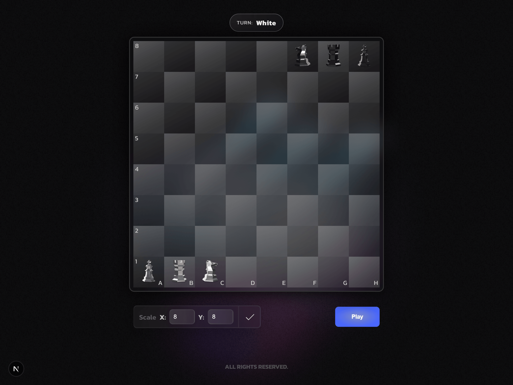

# Dynamic Chess: Dynamic Board with React and Next.js



Dynamic Chess is a local, two-player strategy game built with Next.js, React, and TypeScript. Play on a configurable board and use three pieces with distinct movement and capture rules.

---

## Implemented Features

- **Configurable Board**: Choose the number of columns and rows independently, from 6 to 12, with feedback for invalid dimensions. The game starts on an 8x8 board.
- **Turn-Based Play**: White moves first, followed by alternating turns. The active color is displayed, only that player's pieces can be selected, and the cursor reflects which pieces are available.
- **Move Guidance**: Selecting a piece highlights its valid destination squares. Moves are restricted to the board and cannot end on a square occupied by a piece of the same color.
- **Distinct Piece Rules**: Developer, Designer, and Product Owner each have unique movement and capture behavior.
- **Win Condition**: Capture the opposing Product Owner to win. A result screen offers a new match, resetting the board to its default setup.
- **Responsive Interface**: Board squares scale with the viewport, and the configuration form adapts to smaller screens.
- **SCSS Styling**: Modular stylesheets and shared CSS variables keep the interface styling organized.

---

## Technologies Used

- **Next.js**: React framework for server-side rendering and optimizations.
- **React**: JavaScript library for building user interfaces.
- **TypeScript**: Static typing for application data and component contracts.
- **SCSS (Sass)**: CSS pre-processor for more powerful and organized styles.

---

## How to Run the Project

Follow the steps below to set up and run the project on your local machine:

1.  **Clone the repository:**

    ```bash
    git clone https://github.com/Robson16/dynamic-chess.git
    cd dynamic-chess
    ```

2.  **Install dependencies:**

    ```bash
    npm install
    # or
    yarn install
    ```

3.  **Start the development server:**

    ```bash
    npm run dev
    # or
    yarn dev
    ```

    The application will be available at `http://localhost:3000`.

---

## Game Rules and Pieces

### 1. The Board

The board can have custom dimensions defined by the user before the game starts. The board dimensions must be between **6 and 12 squares** vertically and horizontally.

### 2. The Pieces

**Capture rule:** The Developer captures opposing pieces crossed along its path; its destination must be unoccupied. The Designer and Product Owner capture by moving onto an opponent's occupied square, removing that piece and taking its place. No piece can land on a square occupied by a piece of the same color.

#### 2.1. The "Developer"

- **Movement**: Can jump up to 3 squares per turn in any direction: vertically, horizontally, or diagonally.
- **Capture**: Removes any opposing pieces along its path. The destination square must be empty.

#### 2.2. The "Designer"

- **Movement**: Can jump in an "L" shape, like a knight in chess.
- **Capture**: Captures an opponent by moving onto its square.

#### 2.3. The "Product Owner"

- **Movement**: Can move one square per turn in any direction: vertically, horizontally, or diagonally.
- **Capture**: Captures an opponent by moving onto its square.

### 3. Initial Piece Positions

Coordinates use `(x, y)`, where `x` increases from left to right and `y` increases from top to bottom. For a board with `columns` and `rows`:

- **White Product Owner**: `(0, rows - 1)`, the bottom-left corner.
- **White Developer**: `(1, rows - 1)`, immediately to the right of the White Product Owner.
- **White Designer**: `(2, rows - 1)`, immediately to the right of the White Developer.
- **Black Product Owner**: `(columns - 1, 0)`, the top-right corner.
- **Black Developer**: `(columns - 2, 0)`, immediately to the left of the Black Product Owner.
- **Black Designer**: `(columns - 3, 0)`, immediately to the left of the Black Developer.

### 4. How to Play

- The first turn is for the **White** side.
- To win the game, you must capture the **"Product Owner"** of your adversary.

---
